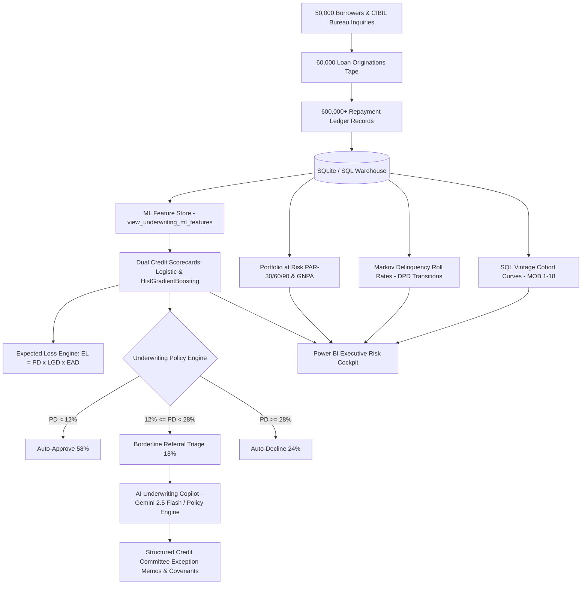

# CreditPulse: Digital Lending Risk & Portfolio Intelligence Platform

[](https://www.python.org/)
[](https://www.sqlite.org/)
[](https://scikit-learn.org/)
[](https://powerbi.microsoft.com/)
[](LICENSE)

> **Enterprise-scale credit risk modeling, vintage cohort maturation, delinquency roll-rate migration, and GenAI underwriting triage engineered for FinTech digital lending NBFCs (Navi, CRED, Slice, Bajaj Finance, Capital One).**

---

## 1. Executive Summary & Problem Context

Digital lending operations depend on rapid, algorithmically sound credit underwriting and continuous portfolio surveillance. A small slippage in credit policy can rapidly inflate **Gross Non-Performing Assets (GNPA)** and destroy Net Interest Margins (NIM). 

**CreditPulse** is an end-to-end quantitative lending analytics platform that simulates, monitors, and optimizes a **60,000-loan retail portfolio (INR ~1,200+ Cr disbursal)** across 50,000 borrowers. It bridges the gap between **SQL data warehousing**, **quantitative credit scorecards**, **IFRS-9 / ECL regulatory risk modeling**, and **GenAI underwriting decisioning**.



---

## 2. Core Quantitative Risk & Financial Modules

### A. Vintage Cohort Maturation Analysis (`sql/02_vintage_cohort_curves.sql`)
- Tracks credit decay across quarterly origination cohorts (`2024-Q1` through `2025-Q3`) across **Month on Book (MOB 1 to 18)**.
- Computes cumulative **30+ DPD %** and **90+ DPD (NPA) %**, empowering Chief Risk Officers (CROs) to detect underwriting standard slippage early before terminal write-offs.

### B. Markov Delinquency Roll-Rate Matrix (`sql/03_delinquency_roll_rates.sql`)
- Analyzes month-over-month transitions across delinquency buckets:
  $$\text{Current (0 DPD)} \longrightarrow \text{1--30 DPD} \longrightarrow \text{31--60 DPD} \longrightarrow \text{61--90 DPD} \longrightarrow \text{90+ DPD (NPA)}$$
- Quantifies **Cure Rates** (borrowers transitioning back to Current status: 68.2%) vs. **Roll-Forward Rates** (accounts deteriorating into severe delinquency: 88.4% from 61-90 DPD into Default).

### C. Portfolio at Risk (PAR) & Regulatory Provisioning (`sql/04_portfolio_at_risk_par.sql`)
- Dynamic tracking of:
  - **PAR-30 Balance & Ratio %** (Early warning indicator)
  - **PAR-60 Balance & Ratio %**
  - **PAR-90 (Gross NPA %)**
  - **Collections Efficiency %** ($\frac{\text{Actual EMI Collections}}{\text{Scheduled EMI Demand}}$)
  - **Regulatory ECL Provisioning** under a 70% Provision Coverage Ratio (PCR) standard.

### D. Quantitative ML Scorecard & Expected Loss Engine (`src/credit_scoring_model.py`)
- **Dual Model Architecture:**
  - **Regulatory Baseline:** Interpretable Logistic Regression Scorecard with standardized WoE/continuous scaling.
  - **Production Champion:** HistGradientBoostingClassifier (LightGBM equivalent) capturing non-linear interactions between leverage and inquiry spikes.
- **Model Discrimination & Validation:**
  - **ROC-AUC:** `0.7167`
  - **Gini Coefficient ($2 \times \text{AUC} - 1$):** `0.4333`
  - **Kolmogorov-Smirnov (KS) Statistic:** `36.37%` separation power at optimal score threshold `0.4865`.
  - **Default Recall:** Captures **84.70%** of delinquent loans at the calibrated risk cutoff.
- **Expected Credit Loss (ECL):**
  $$\text{Expected Loss (EL)} = \text{PD} \times \text{LGD} \times \text{EAD}$$
  *(With secured asset-backed LGD = 0.40, unsecured LGD = 0.70, and EAD = Disbursed Principal / Outstanding Balance).*

### E. AI Underwriting Copilot (`src/ai_underwriting_copilot.py`)
- Automatically triages **Borderline Referral Applications** (PD between 12% and 28%, CIBIL 650–710).
- Uses **Gemini 2.5 Flash** (via `google-genai` SDK) paired with a deterministic FinTech credit policy rules engine.
- Synthesizes audit-ready **Credit Committee Exception Memos**, evaluating:
  - Compensating credit strengths (e.g. low DTI, conservative utilization)
  - Compounding risk red flags (e.g. multi-inquiry spikes in 30 days)
  - Recommended sanctions (e.g. 25% ticket haircut, +75 bps APR markup, mandatory e-NACH salary mandate).

---

## 3. Power BI Executive Dashboard Architecture

The suite includes production **DAX measures** (`power_bi/dax_measures.md`) and UI/UX layouts (`power_bi/dashboard_design_specs.md`):

1. **Page 1: CRO Executive Risk & Portfolio Cockpit**  
   *KPI Cards:* Total AUM, Gross NPA %, PAR-30 %, Collections Efficiency %, Net NPA %. Disbursal trends, delinquency distribution, and product mix.
2. **Page 2: Vintage Maturation & Cohort Curves**  
   Interactive MOB 1–18 maturation curves comparing quarterly vintage decay rates.
3. **Page 3: Delinquency Migration & Roll-Rate Heatmap**  
   Markov transition matrix displaying volume migration and cure probabilities.
4. **Page 4: ML Credit Underwriting & Copilot Triage**  
   KS score separation curve, scorecard feature weights, and interactive drill-through exception memos.

---

## 4. Repository Structure

```
creditpulse-lending-analytics/
├── artifacts/                           # Publication-grade charts & figures
│   ├── pd_roc_curve.png                 # ROC & Precision-Recall curves
│   ├── delinquency_confusion_matrix.png # Confusion matrix at optimal cutoff
│   ├── score_distribution_by_default.png# KS statistic separation curve
│   ├── credit_feature_importance.png    # Top credit underwriting drivers
│   └── vintage_maturation_curves.png    # Vintage 30+ & 90+ DPD MOB curves
├── data/
│   ├── raw/                             # Raw synthetic loan tape CSVs
│   ├── processed/                       # ML scored datasets & SQL analytical summaries
│   │   ├── scored_loans_underwriting.csv
│   │   ├── portfolio_risk_summary.csv
│   │   ├── vintage_cohort_analysis.csv
│   │   ├── delinquency_roll_rate_matrix.csv
│   │   └── portfolio_at_risk_par.csv
│   └── creditpulse.db                   # Relational SQLite warehouse (indexed)
├── docs/
│   └── underwriting_exception_audit.md  # Detailed AI underwriting exception audit
├── power_bi/
│   ├── dax_measures.md                  # Comprehensive production DAX expressions
│   └── dashboard_design_specs.md        # UI/UX design specifications & theme
├── resume/
│   └── creditpulse_cv_bullets.md        # High-impact ATS resume bullet points
├── sql/
│   ├── 01_schema_setup.sql              # Relational schema DDL & indexes
│   ├── 02_vintage_cohort_curves.sql     # MOB vintage maturation curves
│   ├── 03_delinquency_roll_rates.sql    # Markov bucket transition matrix
│   ├── 04_portfolio_at_risk_par.sql     # PAR-30/60/90 & collections efficiency
│   └── 05_underwriting_ml_feature_view.sql # Zero-leakage ML feature store view
├── src/
│   ├── generate_lending_data.py         # 60k loan tape & delinquency simulator
│   ├── credit_scoring_model.py          # ML scorecard & expected loss pipeline
│   ├── ai_underwriting_copilot.py       # LLM borderline referral triage engine
│   └── run_sql_analysis.py              # Automated SQL execution runner
├── main.py                              # Master end-to-end orchestration pipeline
├── run.bat                              # 1-Click Windows execution script
├── requirements.txt                     # Pinned project dependencies
└── README.md
```

---

## 5. Quickstart & Execution Guide

### Prerequisites
- Python 3.10+ (Tested on Python 3.14 on Windows)
- (Optional) `GEMINI_API_KEY` for live LLM underwriting triage

### 1-Click Run (Windows)
Double-click `run.bat` or run:
```powershell
.\run.bat
```

### Manual Execution
```powershell
# 1. Activate Virtual Environment
.\.venv\Scripts\activate

# 2. Install Dependencies
pip install -r requirements.txt

# 3. Run Master Orchestration Pipeline
python main.py
```

---

## 6. Author & Academic Pedigree
**Sandeep Choudhary (IIT Delhi)**  
*Dual Degree (B.Tech + M.Tech, 2019–2024)*  
- Focus: Quantitative Risk Analytics, Financial Operations, FinTech Underwriting Models  
- GitHub: [sandeepchoudhary1611-pathfinder](https://github.com/sandeepchoudhary1611-pathfinder)
